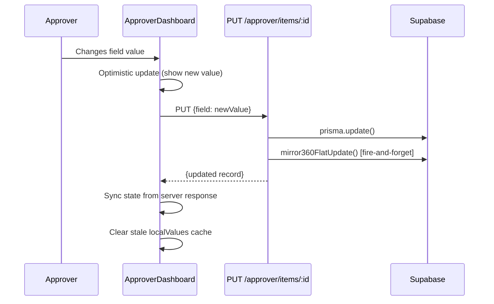
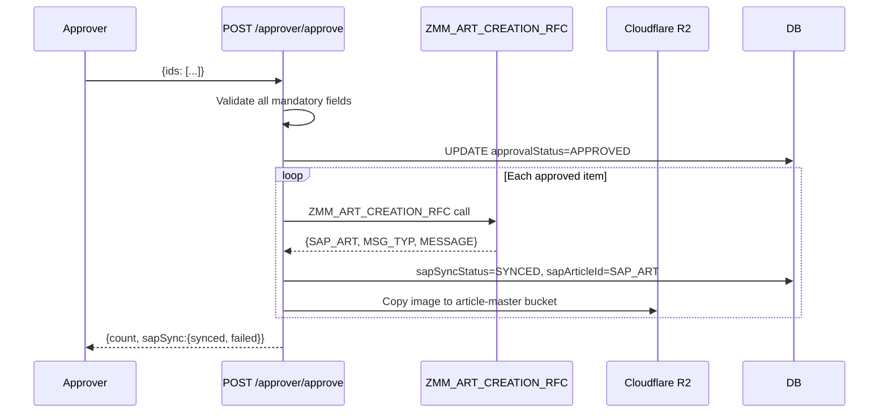

# Approver Flow

#approver #workflow #validation #dashboard

← [[00 - Index]] | [[02 - Full Workflow]]

---

## Approver Dashboard — Full UI Flow

```mermaid
flowchart TD
    LOGIN[Approver logs in] --> DASH[ApproverDashboard\n/approver]
    DASH --> TABS{Path tabs}
    TABS --> NEW[New Articles\npathType=new]
    TABS --> OLD[Old Articles\npathType=old\n10-digit numeric names]
    TABS --> REJ[Rejected\npathType=rejected]

    NEW --> FILTER[Apply Filters\ndivision / subDivision / majorCat\nstatus / date range / search]
    FILTER --> LIST{View mode}
    LIST --> CARDS[Card Grid View\nApproverArticleList]
    LIST --> TABLE[Table View\nApproverTable]

    CARDS --> INLINE[Inline edit dropdowns\nFAB / BODY / VA ACC / VA PRCS]
    CARDS --> VARIANTS[Expand → Variant SubTable\nsize × color matrix]

    CARDS --> EDITBTN[Edit button → Modal]
    EDITBTN --> TAB1[Tab 1: Core Fields\narticleNumber, division, mrp, rate,\nvendorName, designNumber, pptNumber]
    EDITBTN --> TAB2[Tab 2: Attributes\nAll mandatory fields per majCat]
    EDITBTN --> TAB3[Tab 3: Business & SAP\nmcCode, hsnCode, segment,\nimpAtrbt2, articleDescription]

    INLINE & TAB1 & TAB2 & TAB3 --> SAVE[PUT /approver/items/:id\nAuto-derive: mcCode, HSN, description]

    CARDS --> SELECT[Select articles checkbox]
    SELECT --> BATCHAPPROVE[Batch Approve button]
    BATCHAPPROVE --> MANVALID[Mandatory field check\nper majorCategory]
    MANVALID -->|missing fields| BLOCK[Block — show missing list]
    MANVALID -->|all present| CONFIRM[Confirm modal]
    CONFIRM --> APPROVE[POST /approver/approve\n{ids:[...]}]

    SELECT --> REJECT[Reject\nPOST /approver/reject\n{ids, reason}]
```

---

## Filtering & Scoping

### Role-Based Scope (automatic — enforced server-side)

| Role | Division Scope | SubDivision Scope |
|------|---------------|------------------|
| ADMIN | All | All |
| CATEGORY_HEAD | Assigned division only | All sub-divisions |
| APPROVER | Assigned division only | Assigned sub-division only |

### Filter Options (user-controlled)

- **Status**: PENDING / APPROVED / REJECTED / ALL / FAILED (sapSyncStatus=FAILED)
- **Division**: Dropdown (scoped to role)
- **Sub Division**: Cascades from division selection
- **Major Category**: Free text filter
- **Date Range**: createdAt start/end
- **Search text**: Debounced 700ms, min 3 chars — searches articleNumber, imageName, designNumber, pptNumber, vendorName

---

## Mandatory Field Rules

Mandatory fields are driven by `Frontend/src/data/maj-cat-mandatory.json`  
Source of truth: `Backend/data/MANDATORY GRID DATA.xlsx`

### Always Mandatory (regardless of major category)
- `mrp` — must be > 0
- `impAtrbt2` — SAP Important Attribute 2

### Always Optional
- `referenceArticleDescription`

### Per Major Category
Every major category (e.g. "COTTON SHIRTS", "DENIM JEANS") has a list of mandatory attribute keys.  
The approver modal only **shows** fields that are mandatory for that category.  
Approval is **blocked** if any mandatory field is empty.

> Source file: `Frontend/src/data/majCatAttributeMap.ts`  
> Functions: `getMajCatMandatoryKeys(majorCategory)`, `getMajCatAllowedValues(division, schemaKey)`

---

## Inline Card Editing — 4 Groups

In the card view, each attribute group is a collapsible section:

| Group | Fields |
|-------|--------|
| **FAB** | macroMvgr, yarn1, mainMvgr, fabricMainMvgr, weave, mFab2, composition, fCount, fConstruction, lycra, finish, gsm, fOunce, fWidth, shade, weight |
| **BODY** | collar, collarStyle, neckDetails, neck, placket, fatherBelt, sleeve, sleeveFold, bottomFold, noOfPocket, pocketType, extraPocket, fit, pattern, length, childBelt, frontOpenStyle |
| **VA ACC** | drawcord, dcShape, button, btnColour, zipper, zipColour, patchesType, patches, htrfType, htrfStyle |
| **VA PRCS** | printType, printStyle, printPlacement, embroidery, embroideryType, embPlacement, wash, ageGroup, articleFashionType, mvgrBrandVendor |

`impAtrbt2` is always shown as a standalone mandatory dropdown.

### Variants table — shared `VariantGrid.tsx` (2026-10-12, design "Option E")

`approver/components/VariantGrid.tsx` renders the table for FG (`VariantSubTable`), GM (`GMVariantSubTable`) and Fabric (`FabricVariantSubTable`). Each page keeps its own fetching/rules and passes them in:

| | FG | GM / Fabric |
|---|---|---|
| Weight column + "Missing weight" filter + bulk Set weight | yes | no |
| Selectable / deletable | not synced; delete skips colours with a synced variant | approval PENDING (or empty) and not synced |
| Delete colour shown | colour has no synced variant | every variant of the colour is pending |
| Row action | — | Edit (when no fabricArticleNumber) |
| Status pill | Synced / Failed / Needs weight / Pending SAP | Synced / Failed / Synced, no # / Rejected / Pending SAP / Pending approval |

Toolbar actions: Retry Variants to SAP (created page) and Add Color. The **Sync Color** button was removed from all three tables on request (2026-10-12); the backend `/approver/items/:id/sync-color` endpoint is untouched.

SRM-sourced GM/Fabric articles still use `GMArticleVariantSubTable` / `FabricArticleVariantSubTable` (colour-only variants, different data) — not changed.

#### FG details

- Toolbar: filter tabs **All / Missing weight / Not synced** (with counts), selection actions (**Set weight…** bulk PUT `variantWeight`, **Delete** bulk DELETE), then Sync Color · Retry Variants to SAP (created page) · Add Color.
- Checkbox per row; SAP-synced variants can't be selected. Bulk Delete skips colours that already have a synced variant (same rule as the old per-row delete).
- Rows grouped by colour; each group header shows the colour, size count, synced count and **Delete colour** (hidden once any variant of that colour is synced).
- Sizes sorted XS → 5XL (XXL = 2XL), then numeric, then A→Z. Inherited columns (Maj. Cat, Div, Vendor, Rate, MRP) greyed. Status pill: Synced / Failed (tooltip) / Needs weight / Pending SAP.
- Per-row trash icon removed — single delete = tick the row + Delete.

### Hidden card attributes (FG, 2026-10-12)

`FG_CARD_HIDDEN_SCHEMA_KEYS` hides **VALUE ADD PROCESS COST** (`value_add_process_cost`, V. ADD card) and **M_FAB_WEIGHT** (`fab_weight`, OTH GRID-1 card) — UI only. They are still in Supabase/admin config; **pending removal there later**, after which the set can be deleted.

### Article Information card (2026-10-12)

The **Article ID** row is hidden on every FG Articles page (New, Old, Rejected, Created, Failed — i.e. no `allowGroups`). Body articles still show it.

### Card theme — one look for all cards (2026-10-12)

All attribute cards (FAB, BODY, B TRIM, V. ADD, PKG COST, OTH GRID-1, Rough/Precise Consumption) and the active group-tab chips use one theme, `CARD_THEME` in `components/cardTheme.ts` ("Ink Header"): header `#1e293b` with `#f8fafc` text, white body, `#cbd5e1` card border. `GROUP_HEADER_STYLE` maps every group to it; the old per-group colors are retired. Change the theme in that one file. OTH GRID-1 (key `BOM`), ROUGH CONSUMPTION (`ROUGH`) and PRECISE CONSUMPTION (`PRECISE`) collapse via `renderCollapsibleHeader` — same chevron header as the group cards, honours Collapse All. Card action buttons (Create Fabric Article, Create Body Article) share `CARD_ACTION_BTN` from the same file: light slate at rest, header slate `#1e293b` fill on hover (no coral/purple).

### OTH GRID-1 card (FG, 2026-10-12)

The old BUSINESS card ("OTH GRID-1") is no longer rendered for FG articles and its tab is gone. Its attrs are appended to the BOM card, which is now titled **OTH GRID-1** (was OTH GRID-2): Rate, MRP, Base/Secondary Colour, Markdown, After Tax, then M_AGE_GROUP → M_IMP_ATBT → ARTICLE FASHION TYPE → SEGMENT (`OTH_GRID_1_ORDER`), then the rest (No of Size, No of Clr). Body articles (`allowGroups`) unchanged. For FG the card has `order-last`, so it always renders after every other card (incl. PKG COST and the consumption cards). Only the FAB tab is selected by default; PKG COST shows when its tab is clicked.

### PKG COST card (FG, 2026-10-12) — `PkgCostCard.tsx`

New tab **PKG COST** (key `PKG`, cyan). Tabs PKG-1 / PKG-2; columns MAT. DESC | ARTICLE NO | ARTICLE DESC | NET RATE; rows BOPP, CTN, BARCODE, KIMBLE, TAG, THREAD; footer TOTAL NET RATE per tab. No SAP attrs behind it — all values UI-only local state (lost on reload).

### Costing grid cards — `CostingGridCard.tsx` (2026-10-12)

One component, configured per group (`BTRIM_CONFIG`, `VADD_CONFIG`), used for FG articles only. Only the **first tab's** SAP-mapped cells are saved; everything else is UI-only local state.

**V. ADD (VA PRCS):** single table, no tabs. Columns: V. ADD | TYPE | STYLE | PLACEMENT | DESC | AUTO-BGT | ROUGH-V2 | VDR COST | FINAL COST. Rows: PRINT (`printType`/`printStyle`/`printPlacement`), EMB (`embroidery` M_EMB_TYPE / `embroideryType` M_EMBROIDERY_STYLE / `embPlacement`), WASHING (TYPE→`wash`). `valueAddProcessCost` renders as a normal row under the table.

#### B TRIM (VA ACC)

FG articles render the VA ACC group as a full-width table (design "Option B"), not the numbered attribute list:

- Tabs **BT-01** / **BT-02**; same table in both. Mapped cells are SAP-value dropdowns on both tabs; BT-02 picks stay local (not saved).
- Columns: BT DESCRIPTION | TYPE | STYLE | CLR | DESC (auto = `STYLE-TYPE`) | AUTO-BGT (read-only, blank — source pending) | ROUGH-V2 | VDR COST | FINAL COST, with SPECIFICATION / COSTING column-group headers.
- Fixed rows M_BTN, DC, ZIP, PATCH, H-TRF; collapsible **OTHER ACC** (closed by default): ELASTIC, FUSING, BADGE, RIVET, TAPE, OTHER.
- **Saved (BT-01 only)** — cells bound to the existing SAP attrs via the normal `handleSave`, dropdowns use SAP allowed values: M_BTN STYLE→`button` (M_BTN_TYPE), CLR→`btnColour`; DC TYPE→`dcShape`, STYLE→`drawcord`; ZIP TYPE→`zipper`, CLR→`zipColour`; PATCH TYPE→`patches`, STYLE→`patchesType`; H-TRF TYPE→`htrfType`, STYLE→`htrfStyle`. A mapped attr not configured for the MC falls back to a local text cell.
- **Not saved (UI-only local state)** — BT-02, OTHER ACC, unmapped cells and all cost columns. Lost on reload until storage is added.
- Any other attr assigned to the VA ACC group renders as normal rows under the table.

---

## Save Flow (optimistic update, no reload)



**Auto-derivations on save** (server-side):
- `mcCode` ← `getMcCodeByMajorCategory(majorCategory)`
- `hsnTaxCode` ← `getHsnCodeByMcCode(mcCode)`
- `segment` ← `getSegmentByCategoryAndMrp(majorCategory, mrp)`
- `articleDescription` ← 40-char built from ordered attribute fields

---

## Approve → SAP Flow



---

## Article Creation Buttons (⚠️ MISSING BACKEND ROUTES)

Three buttons appear on approved articles in the card view:
- **Create Fabric Article** → calls `POST /approver/create-fabric-article`
- **Create Body Article** → calls `POST /approver/create-body-article`
- **Proceed for FG Article** → calls `POST /approver/proceed-fg-article`

> [!warning]
> These routes are **NOT registered** in `Backend/src/routes/approver.ts` as of 2026-05-02.  
> Clicking these buttons will return 404.  
> See [[13 - Pending Issues]] — this is the top priority fix.
