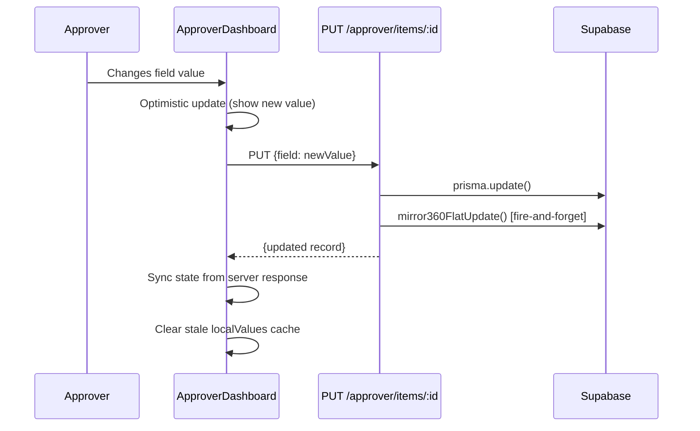
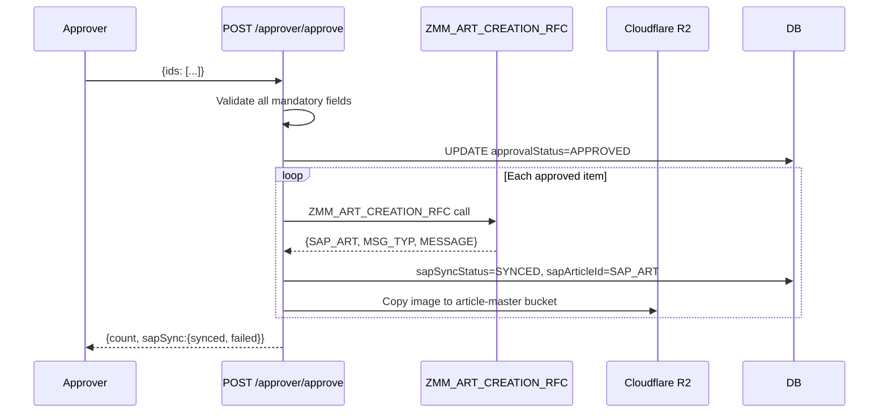

# Approver Flow

#approver #workflow #validation #dashboard

← [[00 - Index]] | [[02 - Full Workflow]]

---

## Approver Dashboard — Full UI Flow

```mermaid
flowchart TD
    LOGIN[Approver logs in] --> DASH[ApproverDashboard\n/approver]
    DASH --> TABS{Path tabs}
    TABS --> NEW[New Articles\npathType=new]
    TABS --> OLD[Old Articles\npathType=old\n10-digit numeric names]
    TABS --> REJ[Rejected\npathType=rejected]

    NEW --> FILTER[Apply Filters\ndivision / subDivision / majorCat\nstatus / date range / search]
    FILTER --> LIST{View mode}
    LIST --> CARDS[Card Grid View\nApproverArticleList]
    LIST --> TABLE[Table View\nApproverTable]

    CARDS --> INLINE[Inline edit dropdowns\nFAB / BODY / VA ACC / VA PRCS]
    CARDS --> VARIANTS[Expand → Variant SubTable\nsize × color matrix]

    CARDS --> EDITBTN[Edit button → Modal]
    EDITBTN --> TAB1[Tab 1: Core Fields\narticleNumber, division, mrp, rate,\nvendorName, designNumber, pptNumber]
    EDITBTN --> TAB2[Tab 2: Attributes\nAll mandatory fields per majCat]
    EDITBTN --> TAB3[Tab 3: Business & SAP\nmcCode, hsnCode, segment,\nimpAtrbt2, articleDescription]

    INLINE & TAB1 & TAB2 & TAB3 --> SAVE[PUT /approver/items/:id\nAuto-derive: mcCode, HSN, description]

    CARDS --> SELECT[Select articles checkbox]
    SELECT --> BATCHAPPROVE[Batch Approve button]
    BATCHAPPROVE --> MANVALID[Mandatory field check\nper majorCategory]
    MANVALID -->|missing fields| BLOCK[Block — show missing list]
    MANVALID -->|all present| CONFIRM[Confirm modal]
    CONFIRM --> APPROVE[POST /approver/approve\n{ids:[...]}]

    SELECT --> REJECT[Reject\nPOST /approver/reject\n{ids, reason}]
```

---

## Filtering & Scoping

### Role-Based Scope (automatic — enforced server-side)

| Role | Division Scope | SubDivision Scope |
|------|---------------|------------------|
| ADMIN | All | All |
| CATEGORY_HEAD | Assigned division only | All sub-divisions |
| APPROVER | Assigned division only | Assigned sub-division only |

### Filter Options (user-controlled)

- **Status**: PENDING / APPROVED / REJECTED / ALL / FAILED (sapSyncStatus=FAILED)
- **Division**: Dropdown (scoped to role)
- **Sub Division**: Cascades from division selection
- **Major Category**: Free text filter
- **Date Range**: createdAt start/end
- **Search text**: Debounced 700ms, min 3 chars — searches articleNumber, imageName, designNumber, pptNumber, vendorName

---

## Mandatory Field Rules

Mandatory fields are driven by `Frontend/src/data/maj-cat-mandatory.json`  
Source of truth: `Backend/data/MANDATORY GRID DATA.xlsx`

### Always Mandatory (regardless of major category)
- `mrp` — must be > 0
- `impAtrbt2` — SAP Important Attribute 2

### Always Optional
- `referenceArticleDescription`

### Per Major Category
Every major category (e.g. "COTTON SHIRTS", "DENIM JEANS") has a list of mandatory attribute keys.  
The approver modal only **shows** fields that are mandatory for that category.  
Approval is **blocked** if any mandatory field is empty.

> Source file: `Frontend/src/data/majCatAttributeMap.ts`  
> Functions: `getMajCatMandatoryKeys(majorCategory)`, `getMajCatAllowedValues(division, schemaKey)`

---

## Inline Card Editing — 4 Groups

In the card view, each attribute group is a collapsible section:

| Group | Fields |
|-------|--------|
| **FAB** | macroMvgr, yarn1, mainMvgr, fabricMainMvgr, weave, mFab2, composition, fCount, fConstruction, lycra, finish, gsm, fOunce, fWidth, shade, weight |
| **BODY** | collar, collarStyle, neckDetails, neck, placket, fatherBelt, sleeve, sleeveFold, bottomFold, noOfPocket, pocketType, extraPocket, fit, pattern, length, childBelt, frontOpenStyle |
| **VA ACC** | drawcord, dcShape, button, btnColour, zipper, zipColour, patchesType, patches, htrfType, htrfStyle |
| **VA PRCS** | printType, printStyle, printPlacement, embroidery, embroideryType, embPlacement, wash, ageGroup, articleFashionType, mvgrBrandVendor |

`impAtrbt2` is always shown as a standalone mandatory dropdown.

### Variants table — shared `VariantGrid.tsx` (2026-10-12, design "Option E")

`approver/components/VariantGrid.tsx` renders the table for FG (`VariantSubTable`), GM (`GMVariantSubTable`) and Fabric (`FabricVariantSubTable`). Each page keeps its own fetching/rules and passes them in:

| | FG | GM / Fabric |
|---|---|---|
| Weight column + "Missing weight" filter + bulk Set weight | yes | no |
| Selectable / deletable | not synced; delete skips colours with a synced variant | approval PENDING (or empty) and not synced |
| Delete colour shown | colour has no synced variant | every variant of the colour is pending |
| Row action | — | Edit (when no fabricArticleNumber) |
| Status pill | Synced / Failed / Needs weight / Pending SAP | Synced / Failed / Synced, no # / Rejected / Pending SAP / Pending approval |

Toolbar actions: Retry Variants to SAP (created page) and Add Color. The **Sync Color** button was removed from all three tables on request (2026-10-12); the backend `/approver/items/:id/sync-color` endpoint is untouched.

SRM-sourced GM/Fabric articles still use `GMArticleVariantSubTable` / `FabricArticleVariantSubTable` (colour-only variants, different data) — not changed.

#### FG details

- Toolbar: filter tabs **All / Missing weight / Not synced** (with counts), selection actions (**Set weight…** bulk PUT `variantWeight`, **Delete** bulk DELETE), then Sync Color · Retry Variants to SAP (created page) · Add Color.
- Checkbox per row; SAP-synced variants can't be selected. Bulk Delete skips colours that already have a synced variant (same rule as the old per-row delete).
- Rows grouped by colour; each group header shows the colour, size count, synced count and **Delete colour** (hidden once any variant of that colour is synced).
- Sizes sorted XS → 5XL (XXL = 2XL), then numeric, then A→Z. Inherited columns (Maj. Cat, Div, Vendor, Rate, MRP) greyed. Status pill: Synced / Failed (tooltip) / Needs weight / Pending SAP.
- Per-row trash icon removed — single delete = tick the row + Delete.

### Hidden card attributes (FG, 2026-10-12)

`FG_CARD_HIDDEN_SCHEMA_KEYS` hides **VALUE ADD PROCESS COST** (`value_add_process_cost`, V. ADD card) and **M_FAB_WEIGHT** (`fab_weight`, OTH GRID-1 card) — UI only. They are still in Supabase/admin config; **pending removal there later**, after which the set can be deleted.

### Article Information card (2026-10-12)

The **Article ID** row is hidden on every FG Articles page (New, Old, Rejected, Created, Failed — i.e. no `allowGroups`). Body articles still show it.

### Card theme — one look for all cards (2026-10-12)

All attribute cards (FAB, BODY, B TRIM, V. ADD, PKG COST, OTH GRID-1, Rough/Precise Consumption) and the active group-tab chips use one theme, `CARD_THEME` in `components/cardTheme.ts` ("Ink Header"): header `#1e293b` with `#f8fafc` text, white body, `#cbd5e1` card border. `GROUP_HEADER_STYLE` maps every group to it; the old per-group colors are retired. Change the theme in that one file. OTH GRID-1 (key `BOM`), ROUGH CONSUMPTION (`ROUGH`) and PRECISE CONSUMPTION (`PRECISE`) collapse via `renderCollapsibleHeader` — same chevron header as the group cards, honours Collapse All. Card action buttons (Create Fabric Article, Create Body Article) share `CARD_ACTION_BTN` from the same file: light slate at rest, header slate `#1e293b` fill on hover (no coral/purple).

### OTH GRID-1 card (FG, 2026-10-12)

The old BUSINESS card ("OTH GRID-1") is no longer rendered for FG articles and its tab is gone. Its attrs are appended to the BOM card, which is now titled **OTH GRID-1** (was OTH GRID-2): Rate, MRP, Base/Secondary Colour, Markdown, After Tax, then M_AGE_GROUP → M_IMP_ATBT → ARTICLE FASHION TYPE → SEGMENT (`OTH_GRID_1_ORDER`), then the rest (No of Size, No of Clr). Body articles (`allowGroups`) unchanged. For FG the card has `order-last`, so it always renders after every other card (incl. PKG COST and the consumption cards). Only the FAB tab is selected by default; PKG COST shows when its tab is clicked.

### PKG COST card (FG, 2026-10-12) — `PkgCostCard.tsx`

New tab **PKG COST** (key `PKG`, cyan). Tabs PKG-1 / PKG-2; columns MAT. DESC | ARTICLE NO | ARTICLE DESC | NET RATE; rows BOPP, CTN, BARCODE, KIMBLE, TAG, THREAD; footer TOTAL NET RATE per tab. No SAP attrs behind it — all values UI-only local state (lost on reload).

### Costing grid cards — `CostingGridCard.tsx` (2026-10-12)

One component, configured per group (`BTRIM_CONFIG`, `VADD_CONFIG`), used for FG articles only. Only the **first tab's** SAP-mapped cells are saved; everything else is UI-only local state.

**V. ADD (VA PRCS):** single table, no tabs. Columns: V. ADD | TYPE | STYLE | PLACEMENT | DESC | AUTO-BGT | ROUGH-V2 | VDR COST | FINAL COST. Rows: PRINT (`printType`/`printStyle`/`printPlacement`), EMB (`embroidery` M_EMB_TYPE / `embroideryType` M_EMBROIDERY_STYLE / `embPlacement`), WASHING (TYPE→`wash`). `valueAddProcessCost` renders as a normal row under the table.

**V. ADD repeat rows (2026-10-19, design "Option B"):** `VADD_CONFIG.repeatable = ['PRINT', 'EMB']`. Each of those rows gets a ×N badge and a dashed **+ Add PRINT / + Add EMB** button under its group; clicking adds PRINT-1, PRINT-2… (numbers only go up, so removing PRINT-1 keeps PRINT-2). Copies use the base row's dropdown values and each has an × to remove it. Copies are **UI-only**: not sent to SAP and not saved to the DB (Save ignores them); they are lost on reload. Canvas: https://claude.ai/artifact/FPx3LDs4EtR7yTVnTYnKAy

#### B TRIM (VA ACC)

FG articles render the VA ACC group as a full-width table (design "Option B"), not the numbered attribute list:

- Tabs **BT-01** / **BT-02**; same table in both. Mapped cells are SAP-value dropdowns on both tabs; BT-02 picks stay local (not saved).
- Columns: BT DESCRIPTION | TYPE | STYLE | CLR | DESC (auto = `STYLE-TYPE`) | AUTO-BGT (read-only, blank — source pending) | ROUGH-V2 | VDR COST | FINAL COST, with SPECIFICATION / COSTING column-group headers.
- Fixed rows M_BTN, DC, ZIP, PATCH, H-TRF; collapsible **OTHER ACC** (closed by default): ELASTIC, FUSING, BADGE, RIVET, TAPE, OTHER.
- **Saved (BT-01 only)** — cells bound to the existing SAP attrs via the normal `handleSave`, dropdowns use SAP allowed values: M_BTN STYLE→`button` (M_BTN_TYPE), CLR→`btnColour`; DC TYPE→`dcShape`, STYLE→`drawcord`; ZIP TYPE→`zipper`, CLR→`zipColour`; PATCH TYPE→`patches`, STYLE→`patchesType`; H-TRF TYPE→`htrfType`, STYLE→`htrfStyle`. A mapped attr not configured for the MC falls back to a local text cell.
- **Not saved (UI-only local state)** — BT-02, OTHER ACC, unmapped cells and all cost columns. Lost on reload until storage is added.
- Any other attr assigned to the VA ACC group renders as normal rows under the table.

---

## Save Flow (optimistic update, no reload)



**Auto-derivations on save** (server-side):
- `mcCode` ← `getMcCodeByMajorCategory(majorCategory)`
- `hsnTaxCode` ← `getHsnCodeByMcCode(mcCode)`
- `segment` ← `getSegmentByCategoryAndMrp(majorCategory, mrp)`
- `articleDescription` ← 40-char built from ordered attribute fields

---

## Approve → SAP Flow



---

## Article Creation Buttons (⚠️ MISSING BACKEND ROUTES)

Three buttons appear on approved articles in the card view:
- **Create Fabric Article** → calls `POST /approver/create-fabric-article`
- **Create Body Article** → calls `POST /approver/create-body-article`
- **Proceed for FG Article** → calls `POST /approver/proceed-fg-article`

> [!warning]
> These routes are **NOT registered** in `Backend/src/routes/approver.ts` as of 2026-05-02.  
> Clicking these buttons will return 404.  
> See [[13 - Pending Issues]] — this is the top priority fix.

### FG left rail — Image / Article Information / Reference & Vendor (2026-10-14, design "Option A · Ink headers")

FG Article tab pages only (`!allowGroups` in `ApproverArticleList.tsx`); GM/Fabric/Body pages keep the old left rail.
- All three cards use the ink header (`CARD_THEME`, same as the attribute cards) via `renderInkCardHeader`. Image card: "1 / 1" pill, always-visible expand button, image file name under the photo.
- **Article Information** and **Reference & Vendor** are collapsible and **closed by default** (`openLeftCards` state, per article view; not tied to Collapse All). While closed the header shows a summary: Info → "92% · Medium 22/51"; Reference & Vendor → "N required empty" (orange) if vendor code/name are missing, otherwise the vendor name.
- Info rows: label/value grid; AI confidence as a dark pill; levels coloured slate (High) / orange (Medium) / red (Low).
- Reference & Vendor fields: label stacked above a full-width value (mono for major category and descriptions), "Click to fill" in grey italics, required-empty in orange. Editing behaviour (`renderHeaderField`) unchanged.

#### Article Image replace + new/old switch (2026-10-21, design "Option A · arrows on the photo", BUILT)

Canvas: https://claude.ai/artifact/3abCij85Q1w2wo2g5EThEx (5 directions; A picked, OLD tag is the same dark style as NEW).

- **Where:** FG Article **Created** tab only (`pathType === 'created' && !allowGroups && !readOnly`) **and** the vendor name starts with `V2 S` (trimmed, any case). Every other tab and vendor sees the unchanged card. The backend applies the same gate (`ApproverController.canReplaceImage`) plus `approvalStatus=APPROVED && sapSyncStatus=SYNCED`.
- **Storage (Cloudflare R2, approved `article-master` bucket):** the live image is `<article>.jpg` and the replaced one is `<article>_OLD.jpg`. The **first** replace copies the current file to `_OLD`. Later replaces only overwrite `<article>.jpg`, so `_OLD` always stays the original creation photo (user's choice). The upload is normalised to JPEG with sharp (EXIF rotate, q90), then gets the same watermark label as the approval flow (`applyWatermarkOrPassthrough`).
- **DB:** new column `extraction_results_flat.old_image_url` (TEXT, `prisma/add_old_image_url.sql`, applied 2026-10-21; Prisma `oldImageUrl`). After a replace, `image_url` = `<r2.dev>/<article>.jpg?v=<ts>`. The `?v=` stamp beats the CDN cache. `old_image_url` = `<r2.dev>/<article>_OLD.jpg`. `getItems` and `getById` (detail page `/approver/created/:id`, used on hard refresh) return `oldImageUrl`. The arrows show only when `old_image_url` is set.
- **API:** `POST /api/approver/items/:id/replace-image` (`requireModifyRights`, multipart `image`, JPG/PNG/WebP ≤15 MB) → `{ imageUrl, oldImageUrl }`. Storage helpers: `approvedKeyFromAnyUrl`, `oldKeyFor`, `approvedObjectVersion`, `approvedViewUrl`, `replaceApprovedImage`.
- **UI (`ApproverArticleList.tsx`, FG left rail):**
  - The header pill reads `1 / 1`, `New · 1 / 2` or `Old · 2 / 2`. The **Replace** button sits in the ink header.
  - With an old image: a NEW/OLD tag (both dark slate), ‹ › arrows on the photo, two dots, and a caption with the file name plus "current" or "original".
  - The zoom modal shows whichever image is being viewed.
  - Replace turns the image area into a drop/browse zone with a preview, a note naming both file names, an XHR progress bar, and Cancel / Upload & replace.
- Not verified live: the write path (R2 copy + put) wasn't run against real images. Read paths were checked on real data (1,388 V2 S created articles).
### CMP COST card — `features/approver/components/CmpCostCard.tsx` (2026-10-14, design "Option A · full matrix")

FG Article tab pages only (`!allowGroups && !isBodyArticle`). No tab of its own: it shows whenever the **BODY** tab is selected, full width, after the PKG COST slot and before ROUGH CONSUMPTION (`showCmpCard`). Collapsible with key `CMP` (follows Collapse All).
- One table: rows CUTTING / STITCHING / IRONING / FINISHING × stages BGT / ACT / VENDOR / FINAL (FINAL group in the dark ink colour) × SAM / SAM VAL / PR VAL.
- CUTTING has no SAM / SAM VAL (shown "—"); every other cell is a numeric input with placeholder "Req.". Locked articles show the cells disabled.
- No total row and no total in the header (user removed both from the design).
- Values are **UI-only local state**, like PKG COST — nothing is saved yet.

### Fabric Article pages — same left rail + FAB card (2026-10-14)

`fabric-article/components/FabricArticleList.tsx` is a separate copy of the FG list, so the FG design was ported there:
- Left rail: Article Image / Article Information / Reference & Vendor with ink headers (`renderInkCardHeader`), stacked Reference & Vendor fields, slate/orange/red levels. Info and Reference are collapsible but **open by default** on Fabric pages (`openLeftCards` starts with both). Article ID row kept for non-SRM items; SRM items show only Category + Created (as before).
- "FABRIC AND CONSTRUCTION" card renamed **FAB** and given the ink theme (`CARD_THEME`); same 14 attributes + Fabric Article No./Desc. No AUTO-BGT / ROUGH-V2 / VENDOR COST / FINAL COST rows and no Create Fabric Article button (FG-only).
- BOM card switched from yellow to the ink header.

### GM Add Color Variants modal — `gm-article/components/GMAddColorModal.tsx` (2026-10-15, design "Option A · 3-step wizard")

New standalone component used by `GMVariantSubTable` (GM Article tab pages). The old inline `AddColorModal` was removed from the GM file; FG (`VariantSubTable`), Fabric and the SRM tables keep their own copy unchanged.
1. **Colors** — searchable checkbox list (color_master via `/approver/colors`, falls back to the COLOR attribute / short list), picked colors as removable chips. A color is greyed out ("already added") only when **every** size already exists for it.
2. **Sizes** — sizes from `/approver/sizes-for-majcat/:majCat`. Per color, **all sizes are ticked by default**; untick to skip (dashed, crossed out). Sizes that already exist for that color are disabled. Select all / Clear all per color; Next is blocked while any color has no size.
3. **Images** — one image per color (`/approver/upload-image`), applied to all its sizes.
Footer shows the live variant count; submit sends `{ colors, sizesByColor, colorImages }`.

Backend `ApproverController.addColor` now also accepts `sizesByColor` (`{ COLOR: [sizes] }`); per-color sizes win over the global `sizes` list, all are validated against the major category's sizes, and `addColorVariants` still skips existing size × color pairs.

#### GM variants now use `gm_variants_article_data` (2026-10-15)

All GM articles in `gm_article_data` are `source = SRM`, so the GM page renders `GMArticleVariantSubTable` — which used to call the **fabric** variant endpoints (`/fabric-article-data/...`) and never touched the GM table. Fixed:
- New endpoints (ApproverController): `GET /approver/gm-articles/:genericId/variants`, `POST /approver/gm-articles/:genericId/variants` (`{ colors, sizesByColor, colorImages }` → one row per color × size, existing pairs skipped, sizes validated against the GM size master, image required per color), `DELETE /approver/gm-article-variant/:id` (not once approved), `GET /approver/gm-sizes-for-majcat/:majCat` (from `gm_size_master`, ACT + T-ACT, raw SQL because the generated Prisma client has no GmSizeMaster delegate).
- `GMArticleVariantSubTable` reads/deletes via those endpoints, shows a **Size** column, and opens `GMAddColorModal` (`source="gm"`). Its old inline modal and the fabric "Retry to SAP" button were removed (there is no SAP submission for GM variants yet).
- `GMAddColorModal` takes `source: 'gm' | 'flat'`; `GMVariantSubTable` (FG-flat GM items) passes `flat` and keeps using `/items/:id/add-color` + `maj_cat_sizes`.
- Major categories with no rows in `gm_size_master` (e.g. LS_W_SLING_PURSE today) show a warning on the Sizes step and the API returns 422.

#### GM variants table = FG grid (2026-10-16)

`GMArticleVariantSubTable` and `GMVariantSubTable` were deleted (only GMArticleList used them). GM Article tab pages now render `gm-article/components/GMVariantTable.tsx` for every item: the FG `VariantGrid` (filters, colour groups, multi-select delete, Delete colour) on top of the GM logic — rows from `GET /approver/gm-articles/:id/variants`, delete via `DELETE /approver/gm-article-variant/:id` (only PENDING, no article #), Add Color via `GMAddColorModal`. `variantArticleNumber` is mapped to `sapArticleId` for the grid. No weight column or Edit (weight isn't sent in the variant RFC).

**GM variants → SAP (2026-10-16):** same RFC as FG, `ZMM_VAR_ART_CRT_V8` (via `syncVariantsToSapViaRfc`), with `GENERIC_ARTICLE` = `gm_article_data.gm_article_number`. `services/zmmGMVarArtCreationService.ts → syncGmVariantsToSap(genericIds)` approves PENDING variants, back-fills `generic_article_number`, sends every variant with no `variant_article_number`, and writes `sap_sync_status` / `sap_sync_message` / `variant_article_number`. Called automatically by `POST /approver/gm-articles/submit` for generics that were created (response gets `variants: { synced, failed, skipped }`), and by `POST /approver/gm-articles/:genericId/retry-variants`, which is the "Retry Variants to SAP (n)" button on the GM Created page. No PO-Wise handoff.

**GM images → article-master bucket (2026-10-16), same as FG:**
- Generic: after `ZMM_ART_CRT_V3` succeeds, `submitGmArticles` copies `gm_article_data.image_url` to `<gm_article_number>.<ext>` with the watermark label (article no, PPT no, vendor, div, sub-div, maj cat, design no, MC code, HSN, season, rate, MRP, approver name) and saves the new URL. Upload failure is appended to `sap_sync_message`.
- Colours: `syncGmVariantsToSap` (auto after submit, and Retry Variants — which is what a colour added on the Created page goes through) copies each SAP-created variant's image to `<generic no without leading zeros>-<COLOR>.<ext>` (no watermark, one upload per colour) and updates `image_url`. Variants already synced whose image isn't in the bucket yet are caught too. `GMAddColorModal` lost its `source` prop — it always writes `gm_variants_article_data`. The `gm_variants_article_data` table is unchanged.

### FG Articles dashboard header — `approver/pages/ApproverDashboard.tsx` (2026-10-19, design "Option C · two rows")

The single dark strip with up to 7 outlined buttons became two rows (same handlers, nothing removed):
1. **Title row** (ink #1e293b): page title + "division · sub-division · N articles"; the division tabs (All divisions · Mens · Ladies · Kids) sit on their own line below, on the left (as before). No "Updated … ago" text (removed 2026-10-19 at the user's request).
2. **Action row** (white; light slate when cards are ticked):
   - Left: "N selected · Clear · Export selected · Reject selected" (Reject only on the New page), or a hint "Tick cards to export (or reject) them together".
   - Right: **Refresh** button (spins while loading), then the **Download** group — "All N" on every page; on Created: All · With variants · Rough costing · Precise costing (each shows a spinner while exporting).
- Coral avatar dot replaced with slate.

#### Shared header component (2026-10-19)
The two-row header now lives in `shared/components/articles/ArticleListHeader.tsx` and is used by **FG Articles** (`ApproverDashboard`), **Fabric Article** (`FabricArticleDashboard`), **Fabric › FG New Articles** (`FGNewArticleDashboard`, was a purple gradient — now the same ink) and **GM Article** (`GMArticleDashboard`). Props: title, scope, totalCount, divisionTabs, selection (count / clear / export selected / optional reject), loading + onRefresh, downloads[]. Reject only on the FG New page; Created pages get "All · With variants" (FG Created also Rough / Precise costing). Body Article dashboard not changed.
- 2026-10-19: `DivisionTabs` (ArticleFilters.tsx, used on all dashboards) — coral 3px underline replaced by a grey (slate-400) 3px full-width line under the active tab; inactive tabs slate-300, hover shows a slate-600 line.

- 2026-10-19: V. ADD repeat rows (Add PRINT / Add EMB) now take the lowest free number — delete PRINT-1 and add again gives PRINT-1, not PRINT-2 (`addRepeat` in CostingGridCard.tsx).

- 2026-10-19: V. ADD extra PRINT / EMB rows are saved. New jsonb columns on `extraction_results_flat`: `vadd_print_json` (PRINT-1, PRINT-2…) and `vadd_emp_json` (EMB-1…), each an array of `{ no, type, style, placement, autoBgt, roughV2, vdrCost, finalCost }`. Saved with the card's Save button (sent as a JSON string, parsed by `parseVaddJson` in ApproverController; empty → NULL), loaded back on open. App only — not in FLAT_TO_RFC, never sent to SAP. Excluded from history_fg_article; modify_log stores the JSON text. Copied when an article is duplicated (copy / kids duplication).

- 2026-10-19: V. ADD only — AUTO-BGT is a typed input (`editableAutoBgt` in VADD_CONFIG); saved with Save like the other costs. B TRIM keeps AUTO-BGT read-only (master / RATE × QTY).
