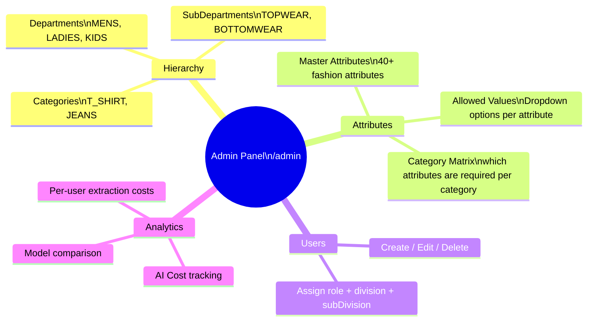

# Admin Panel

#admin #hierarchy #attributes #users

← [[00 - Index]]

---

## What the Admin Panel Manages



---

## Hierarchy Management

**Endpoint prefix**: `/api/admin/`

```
GET/POST/PUT/DELETE  /departments
GET/POST/PUT/DELETE  /sub-departments  (filter: ?departmentId=)
GET/POST/PUT/DELETE  /categories       (filter: ?subDepartmentId=)
```

**3-level hierarchy**:
```
Department (MENS)
  └── SubDepartment (TOPWEAR)
        └── Category (T_SHIRT)
              └── CategoryAttribute (which attributes are required)
```

---

## Master Attributes

Each attribute has:
```
key                  — e.g. "neck", "weave", "gsm"
label                — Display label e.g. "Neck Type"
type                 — TEXT | SELECT | NUMBER
description          — Human description
displayOrder         — Sort order in UI
isActive             — Show/hide in extraction
confidenceThreshold  — Min AI confidence to accept value (0.0-1.0)
rangeConfig          — For NUMBER type: {min, max}
validationRules      — Custom validation JSON
```

---

## Attribute Allowed Values

Per attribute, a list of valid dropdown values:
```
shortForm     — e.g. "rn"
fullForm      — e.g. "round neck"
aliases       — ["ROUND", "ROUNDED"]
displayOrder  — Sort order
```

When AI extraction runs, it matches its output against these values (tokenization + alias matching).

---

## Users Management

**Endpoint**: `/api/admin/users`

| Action | Endpoint |
|--------|---------|
| List all users | GET /api/admin/users |
| Create user | POST /api/admin/users |
| Update user | PUT /api/admin/users/:id |
| Delete user | DELETE /api/admin/users/:id |

Fields managed:
- email, password (bcrypt), name, role
- division, subDivision (scoping for APPROVER/CATEGORY_HEAD)

**UI** (`features/admin/pages/UsersManagement.tsx`, redesigned 2026-10-07 — option A of a 5-option canvas):
- Toolbar: search (name, email, division, sub-division, role) · role chips with counts (roles present in
  the current status+search set) · status switch **All / Active / Inactive**, default **Active** (the page
  used to hide deactivated users entirely; they are now viewable, faded).
- Columns: User (initials + name + email) · Role (colour by family: admin slate, approvers/heads blue,
  creators green, PO committee violet, planning amber, PD pink) · Access scope (division names + first 6
  sub-division chips, "+N more" expands in place; ADMIN = "All access") · Business division · Last login
  (relative + exact; "Never signed in") · Status (dot) · Actions (Edit, Deactivate icon buttons).
- 25 rows per page by default with a size changer. Bulk upload unchanged.
- **Add / Edit user dialog** (option A of a 5-option canvas): sections Account · Role · Access scope.
  Email is shown locked when editing; the password field hides behind "Set a new password" on edit (always
  shown on create). Role labels are humanised (values unchanged). Access scope (only for CREATOR / APPROVER /
  CATEGORY_HEAD / SUB_DIVISION_HEAD, sub-divisions only for CREATOR / APPROVER / SUB_DIVISION_HEAD) is
  `AccessScopeEditor`: division toggle buttons ("3/7", "Add"), then per division a chip grid of sub-division
  codes with Select all / Clear all. Codes held that no selected division lists show under "Other codes".
  Turning a division off still goes through `handleDivisionChange` → "Remove Division" confirm.
  Footer: Deactivate user (not self, active only) · Cancel · Save changes. All states slate, not coral.

---

## Analytics / Expenses

**Route**: `/admin/expenses`  
**Data**: `CostSummary` table

Tracks per extraction:
- `tokensUsed` — tokens consumed
- `costUsd` — estimated cost
- `modelUsed` — which AI model
- `processingTimeMs` — latency

Views:
- Cost overview (total, per day)
- Model comparison (Claude vs GPT-4o)
- Per-category cost breakdown
- Per-user breakdown

### Admin Dashboard layout (`pages/Admin.tsx`, redesigned 2026-10-07 — option A)

Building blocks in `features/admin/components/DashboardParts.tsx`:
- **JumpNav** — sticky "On this page" menu: Pipelines · Vendor sync · Master data (18) · Analytics
  (sections have ids `pipelines`, `vendor`, `masters`, `analytics`).
- The old Total / Completed / Failed / Pending counter tiles were removed at the user's request, and with them
  the whole stats API: `GET /api/admin/stats` (`adminController.getDashboardStats`, 4 COUNTs on
  extraction_results_flat), `backendApi.getAdminStats`, `adminApi.getDashboardStats`, the unused
  `useDashboardStats` hook, both `DashboardStats` types and the `test-admin-stats.ts` / `test-api-stats.js` scripts.
- **Pipelines** — one card, a `PipelineRow` each for `raw_articles`, `fabric_raw_data`, `gm_raw_data`
  (stacked progress bar + counts, View data, the original run Popconfirm), plus the SRM fetch tool
  (by date / by PPT number) at the bottom.
- **Vendor sync** — one compact row (records, last sync, source, View data, refresh, Sync now Popconfirm).
- **Master data** — 18 `MasterDataCard`s in collapsible `MasterGroup`s: FG Attributes & Grid (7; renamed 2026-10-22, cards "FG Major Category Grid Values" and "FG Major Category Details"), GM (2),
  Fabric & body (4), Costs and Broader Menu (3; was Costs + Hierarchy & menus until 2026-10-22, Hierarchy Excel removed). Each card shows status (Uploaded / Not uploaded /
  Unknown), rows, last upload, and Upload / View / Download / Template / refresh. **Upload** expands the card
  (full width) to show its original status details + upload panel; it stays expanded while that upload runs
  (Hierarchy also while a preview awaits confirmation). Upload logic per card is unchanged.
  `MASTER_DATA_COUNT` in Admin.tsx must be updated if a card is added.
- **Analytics** — expense / image overview and the detailed tables at the end (the static "Admin Overview"
  help card and the "Debug Info" card were removed).

### View Data page (`pages/ExpenseTableDetailPage.tsx`, option E)

Breadcrumb back to the dashboard (or Expense Data for non-admins), title + row count + description, actions
(Change requests, Download master, Propose new row), the approval rule as a slim note, a toolbar (search on
Enter, active column filters as removable chips, sort + direction), the table with outlined propose-edit /
propose-delete icons, and the request form as an inline **side panel** (`RowChangeRequestDialog`
`variant="panel"`, keyed by row so each row gets a fresh form). In edit mode each field shows "Current: …"
and marks "· changed". The dialog variant is still the default for other callers.

---

## Mandatory Grid Sync Script

**Script**: `Backend/scripts/sync-mandatory-grid.ts`

Reads `Backend/data/MANDATORY GRID DATA.xlsx` and:
1. Writes `Frontend/src/data/maj-cat-mandatory.json` (JSON array per major category)
2. Updates `CategoryAttribute.isRequired` in DB for every category/attribute pair

Run:
```bash
cd Backend
ts-node scripts/sync-mandatory-grid.ts
# Flags:
#   --json-only   Only write JSON, skip DB
#   --db-only     Only update DB, skip JSON
#   --dry-run     Print changes without writing
```

### Hierarchy › Grid Values tab — `features/admin/components/GridValuesEditor.tsx` (2026-10-19, design "Option A · three-pane browser")

Replaced the nested accordions + values modal with three panes (stacks on narrow screens), same `/api/admin/grid-values/*` endpoints and query keys:
1. **Attributes** — search box; attributes listed under their group (Construction & Fabric, Body & Construction, …). Opens on the first attribute.
2. **Major categories** for the picked attribute, with value counts and search. If the search matches nothing, "Add values for <CODE>" opens an empty category (same as the old "Add" link).
3. **Values** for the picked attribute × major category — Add box (Enter works; duplicates warned), values as removable chips; **History** tab (ADDED / REMOVED, reason, who, when IST).
- The reason prompt is now an inline amber bar in pane 3 (Enter confirms, Esc cancels) instead of a second dialog; still required for every add/remove and saved to the audit log. The chip being removed shows struck-through while the bar is open.
- Slate selection states; no coral.

### Hierarchy › Hierarchy tab — `features/admin/components/HierarchyTreeEditor.tsx` (2026-10-19, design "Option C · department tabs + sub-department cards")

Replaced the side-by-side department columns with:
- **Department tabs** (name + category count) and an inline **+ Department**; a search box scoped to the selected department (sub-department names/codes and category names/codes).
- Department line: rename (pencil), "N sub-departments · N categories", **+ Sub-department** (name + optional code; code defaults to NAME_UPPER_SNAKE), and **Delete department only when it has no sub-departments**.
- **Sub-department cards** (name, code, category count, size bar relative to the biggest card). Clicking a card opens a side panel: rename the sub-department, list its categories (rename in place, **Deactivate / Activate** with confirm, "inactive" tag), **Add category** (name + optional code), and **Delete sub-department only when it is empty**.
- Why deletes are limited: backend `deleteCategory` also deletes that category's `extraction_jobs`, and deleting a sub-department removes its categories — so categories are deactivated (`isActive`) instead of deleted, and only empty departments / sub-departments can be deleted.
- Uses the existing admin endpoints (`/departments`, `/sub-departments`, `/categories`); no backend change. The unused `onCategorySelect` prop was dropped.

### Hierarchy › Size Master tab — `features/admin/components/SizeMasterEditor.tsx` (2026-10-19, design "Option A · two panes")

Replaced the flat list + modal with two panes (stack on narrow screens):
- **Left:** search (major category name or an exact size, e.g. "3XL"), division chips (All / KIDS / LADIES / MENS), categories grouped under "DIVISION · SUB-DIVISION" headers, each showing its size range ("S – 3XL") and count. Opens on the first category. No match → "Add sizes for <CODE>".
- **Right:** "DIVISION › SUB-DIVISION" + category; **Sizes · N** / **History** tabs; Add box (Enter works, duplicates warned); sizes as chips in **real size order** (`compareSizes`: letter scale XS→7XL with 2XL/3XL aliases, kids ages by months with Y = 12, then numbers 28→40, then text); **Quick add** — sizes sibling categories in the same sub-division use that this one lacks; inline amber reason bar (Enter confirms, Esc cancels) instead of a second dialog.
- Backend `GET /api/admin/size-master/categories` now also returns `division`, `subDivision` and `sizes[]` per category (same `majorCategory` / `count`).
- Fix: `POST /size-master/add` now copies `division` and `sub_division` (as well as `mc_code`) from the category's existing rows, so new sizes are no longer saved without them.
- Data source: `maj_cat_sizes` (rows with `status = ACT`), grouped per `major_category` with `MAX(division)` / `MAX(sub_division)`. The React Query key is `['size-master-categories', 'v2']` with a 30 s staleTime, so an older cached response without division can't linger. Categories with no division are grouped under "Unassigned".

### Hierarchy Management page frame — `features/admin/pages/HierarchyManagement.tsx` (2026-10-19, design "Option A · ink header")

- One dark slate header (`bg-slate-800`) holds "ADMIN PANEL", the title, subtitle and an outlined **Export JSON** button; the Grid Values / Size Master / Hierarchy tabs sit on its bottom edge as underline tabs (active = white text + `slate-400` 3px line, same as the article dashboard division tabs).
- The active tab's white card attaches directly under the header (no separate header card, no ui-tw `Tabs`). Each tab's help line comes from the `TABS` array; only the active editor is mounted.
- Canvas: https://claude.ai/artifact/GxFmi1YhVJ8Bf3J7BzPYjJ (A ink header · B one card · C left rail · D tiles · E compact toolbar).

### Modification Logs page — `features/admin/pages/ModificationLogsPage.tsx` (2026-10-19, design "Option A · grouped changesets")

- Lists **saves**, not rows: `GET /api/admin/modify-logs/groups` (`getModifyLogGroups`) paginates distinct `modificationGroupId`s (20/page, newest first) and returns each with ALL its rows plus `fieldCount`, `failedCount`; response also has `total` (saves), `totalChanges`, `failedChanges`. A save is listed if any row matches the filters.
- Shared `buildModifyLogsWhere()` builds the filter for both endpoints; `sapStatus=FAILED` means "anything not SUCCESS".
- Flat `GET /modify-logs` (used only by Export Excel) now allows `limit` up to 10000 — it was capped at 200, so exports were silently truncated to 200 rows before.
- UI: date presets (All / Today / 7d / 30d / Custom), debounced live search, Article / Field / Person / SAP facet popovers (Person = name, or email if it contains `@`), removable active chips. Each save is an expandable card (newest open by default) splitting changes into SAP attributes (`M_*`) and Costing & other fields, Before → After with strikethrough, readable labels. The old group-details modal is gone (`getModifyLogsByGroup` stays in the API).
- Canvas with all 5 options: https://claude.ai/artifact/SpNA2MdrtFqf3NB9MiFCkh

### Pool B Uploader page — `features/admin/pages/PoolBUploaderPage.tsx` (2026-10-19, design "Option D · job console")

- Flow: drop/browse Excel → preview runs automatically (no SAP call) → "Ready to run" card (counts, warnings, batch note, sample) with QA/PROD and Test/Live segmented controls → inline confirm (replaces `window.confirm`; live PROD requires typing PROD) → console.
- Console is the same for sync reports and async jobs: dark slate panel with status pill, % and ok/failed/waiting bar, one tile per batch; below it **Needs attention** built from per-article results (`results` JSON on `pool_b_batches`, or the sync report): NIC / Locked / Error tags, MC, what-to-do text, filter chips, .xlsx download. A running batch's articles only appear once that batch finishes.
- No backend change. Canvas with all 5 options: https://claude.ai/artifact/U2AAwYLJxHF9BPKwSpugRa

### Admin Dashboard header — section links (2026-10-22, Option B built)

The "On this page" side box (`JumpNav`) is to move into the dark header. Canvas: https://claude.ai/artifact/M2wWzqr7nVYHueF75dh9qo
- A: tabs row
- B: one-row segmented
- C: sticky status bar
- D: stat tiles
- E: chips

**Option B built.** `JumpNav` in `DashboardParts.tsx` is now a segmented control for the dark header: a white pill for the current section and count badges. In `Admin.tsx` it sits between the "Admin Dashboard" title and the buttons. The subtitle and the left "On this page" box are removed, so the content is full width. Checked in a local test page; not checked signed in.

### Master data — Hierarchy Excel removed, Broader Menu moved (2026-10-22)

- **Hierarchy Excel card removed**: its state, handlers and types in `Admin.tsx`, the routes `GET /admin/hierarchy/excel-status` and `POST /admin/hierarchy/upload-excel`, and the "HIERARCHY EXCEL UPLOAD" block in `adminController.ts`. The `departments` / `sub_departments` / `categories` tables are kept; extraction still reads them. Hierarchy is managed in the Admin › Hierarchy tab (`major_category_details`).
- The **Broader Menu** card moved into the Costs group, renamed **"Costs and Broader Menu"** (3 datasets). The "Hierarchy & menus" group is gone. The Master data count is now 21.
