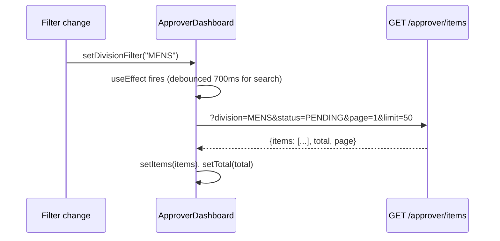

# Frontend Architecture

#frontend #react #components #pages

← [[00 - Index]]

---

## Page / Route Map

```mermaid
flowchart LR
    subgraph PUBLIC["Public"]
        LOGIN[/login]
        REG[/register]
    end

    subgraph CREATOR["Creator (non-approver)"]
        DASH[/dashboard]
        PROD[/products]
        EXT[/extraction/simplified]
        PROF[/profile]
    end

    subgraph APPROVER_ROUTES["Approver"]
        APPR[/approver → New Articles]
        APPR_OLD[/approver/old-articles]
        APPR_REJ[/approver/rejected]
        PO[/po-presentation]
    end

    subgraph ADMIN_ROUTES["Admin only"]
        ADM[/admin/dashboard]
        HIER[/admin/hierarchy]
        USERS[/admin/users]
        EXP[/admin/expenses]
    end
```

---

## Feature Modules (`Frontend/src/features/`)

| Feature | Path | Key components |
|---------|------|---------------|
| `approver` | `features/approver/` | ApproverDashboard, ApproverArticleList, ApproverTable, VariantSubTable |
| `extraction` | `features/extraction/` | SimplifiedExtractionPage, AttributeTable, AttributeCell |
| `admin` | `features/admin/` | AttributeManager, CategoryManager, UsersManagement, HierarchyManagement |
| `analytics` | `features/analytics/` | CostOverview, ModelComparison, CategoryCostTable |
| `dashboard` | `features/dashboard/` | Dashboard, Products, UploadsList, UploadDetail |
| `auth` | `features/auth/` | Login, Register |
| `po-presentation` | `features/po-presentation/` | POPresentationPage |

---

## Article list dashboards — shared card grid (2026-10-06)

All five list dashboards — `ApproverDashboard` (FG Articles: New/Old/Rejected/Created/Failed),
`FabricArticleDashboard`, `FGNewArticleDashboard`, `BodyArticleDashboard`, `GMArticleDashboard` —
render their cards through one shared module in `shared/components/articles/`:

```
<Dashboard>
├── Brand strip: title · count · actions, then DivisionTabs (All / Mens / Ladies / Kids)
├── Filter row (all controls h-9): search · [status] · sub-div · major category · [source]
│   · DatePresetFilter (Any / Today / 7 days / 30 days / Custom…) · ── spacer ── · GroupByControl
│   └── line 2: [Created tab: SapSyncChips (All / Synced / Queued / Failed)] · ── · ResetFiltersButton · Select page
│       Selected segments/chips use dark slate (ACTIVE_SEGMENT_CLASS), not the coral primary.
│       Filter-row fields override the theme's coral hover/focus/open ring with slate classes
│       (hover:border-slate-400, focus-visible / focus-within / data-[state=open] → border-slate-500 + ring-slate-400/25).
└── ArticleCardGrid           ← flat grid, or collapsible groups
    ├── group header: vendor initials / category icon, count, cost range,
    │                  "N missing MRP", Select all / Deselect all, collapse
    └── ArticleSpecCard × N   ← "Spec Sheet" card (design option B)
        ├── 3:4 photo (click → zoom/rotate/pan dialog)
        ├── Division › Sub-div, Major category, select checkbox
        ├── badges: status (not shown for PENDING), article no., SAP sync
        ├── Design no. · Added/Approved date · Vendor (+code, 2-line wrap)
        ├── Cost | MRP | Margin %  (amber "No MRP" when cost set, MRP null)
        └── selected / hover / focus = slate border + ring-slate-400/25, checkbox accent-slate-800 (no coral)
```

- The four old per-feature cards (`ArticleCard`, `FabricArticleCard`, `BodyArticleCard`, `GMArticleCard`) were deleted.
- `useArticleGroupBy(storageKey, ?groupBy)` — choice seeded from URL, then localStorage
  (`articleGroupBy:/approver`, `:fabric`, `:fabric-fg`, `:body`, `:gm`), default `none`.
- When grouped the dashboard sends `groupBy=vendor|category` to its list endpoint; the backend
  (`ApproverController.findGroupedPage`) orders groups (`vendorCode` or `majorCategory`) by their **newest**
  article — createdAt, or approvedAt on Created — so today's vendor/category is on page 1, rows newest-first
  inside a group. It runs a Prisma `groupBy` (_max date, _count), sorts groups in JS, then fetches only the
  group slices on the requested page; a group stays together across the 50-per-page pagination. Vendor groups key on **vendor code** (one name can have
  several codes, e.g. V2 SMART 302099 / 201082).
- Filter pieces live in `shared/components/articles/ArticleFilters.tsx` (filter bar design option C). Division
  tabs replace the old Division select (shown under the same `showDivisionFilter || isUnscoped` rule).
  `DatePresetFilter` writes the dashboards' existing `dateRangeFilter`, so fetch / URL / export code is unchanged;
  the active preset is inferred from the stored range. Reset clears every filter (not status on Created) and
  remounts the uncontrolled search input via a `searchKey`.
- Margin = (MRP − cost) / MRP. Fabric list rows carry `rate: null` (their rate column is mapped to `mrp`), so Fabric cards show Cost "—".

## GM Article review page — design H, compacted to K (2026-10-07)

`gm-article/pages/GMArticleDetailPage.tsx` (sticky slate header: back, ‹ n / N ›, Reject, Save & Submit)
renders one `GMArticleList` card. The card (`gm-article/components/GMArticleList.tsx`, `ArticleCard`) was
rebuilt from design H of the "GM Article Review Options" canvas, then shortened per option K
(5:4 photo, paired detail fields, grid two attributes per line, one-line BOM, full-width colour variants):

```
ArticleCard
├── Slate strip: checkbox · "MAJCAT · design no." / vendor · PPT · article no. · status · SAP remark · [Modify] [Duplicate]
├── Left rail (clamp(360px, 42%, 560px))
│   ├── Photo, 5:4, click / ⤢ → zoom-rotate dialog
│   └── Article details (header shows Created; fields save on blur / Enter, only when changed)
│       two per line: Division ▾ | Sub-division ▾ · Major category ▾ | MC description ▾ (searchable, hierarchy-filtered)
│       Design number | Article number · Article description (full width)
│       Vendor code * (6 digits, resets on invalid) | Vendor name * (vendor-search autocomplete)
└── Right column
    ├── General merchandise grid — rows = preloadGMGridFor(majorCategory); never hard-coded.
    │   Two sections only: Required (mandatory) / Optional, grid order kept. Two attributes per line once the
│   card is ≥ 42rem wide (`@container` + `@2xl:grid-cols-2`), 48px rows with a 4px gap between name and code. Label = familyName,
    │   or derived from the code (GM_LENGTH_CM → "Length (cm)") with the family code under it (mono 11px, slate-500).
    │   Empty = dashed "Choose…"; empty required = red "Required — choose…"; pill "Required x/y".
    ├── BOM card (separate, one line when it fits: auto-fit minmax(110px)): Cost/rate *, MRP *, Markdown, After tax,
    │   Base colour, Fashion type *, Segment *
    └── Proceed for FG Article Creation (not on New / Failed)
└── Colour variants card — full width under both columns (generic articles only)
```

- All states are slate (open/focus border-slate-500 + ring-slate-400/25, selected option bg-slate-100);
  the header's Save & Submit is white-on-slate and Reject is an outline button (were coral / red).
- Removed from the card: the old "Article Information" block (AI confidence, image quality, attribute match),
  the "Reference & Vendor" click-to-edit list, the inline division / design editors in the strip, legend,
  and Collapse all.
- Save behaviour is unchanged (`handleSave` → `onSave`, or staged `pendingChanges` in Created/modify mode;
  `MODIFY_LOCKED_FIELDS` still disable their inputs).
- Article description is a manual text field for now. **Pending:** the business will give the attribute
  sequence for an auto-built GM description (auto-filled but editable, no length limit).

## Key Component Hierarchy (Approver Flow)

```
ApproverDashboard.tsx
├── Filter bar (status, division, subDivision, majorCategory, dateRange, search)
├── Export button
├── ApproverArticleList.tsx  ← Card grid view
│   ├── Article card × N
│   │   ├── Image thumbnail
│   │   ├── Status badge
│   │   ├── PPT number / design number
│   │   ├── 4 collapsible attribute groups (FAB / BODY / VA ACC / VA PRCS)
│   │   │   └── Inline dropdown per field
│   │   ├── impAtrbt2 dropdown (always shown, mandatory)
│   │   ├── Edit button → Modal
│   │   ├── Approve / Reject buttons (PENDING only)
│   │   ├── Create Fabric Article button  ⚠️ 404 — no backend route
│   │   ├── Create Body Article button    ⚠️ 404 — no backend route
│   │   └── Proceed FG Article button     ⚠️ 404 — no backend route
│   └── VariantSubTable.tsx  (expandable)
│       ├── Size × Color grid
│       └── Add Color dialog
└── ApproverTable.tsx  ← Table view (alternative)
```

---

## State Management

- **TanStack Query** — server state (article list, attribute dropdowns, variants)
- **React useState** — local UI state (filters, modal open/close, editing item)
- **Optimistic updates** — applied immediately on field change, synced from server response
- **localValues cache** — temporary map of `{itemId: {field: value}}` for UI consistency
  - Cleared on server response sync to avoid stale values

---

## Data Flow: Article List Load



---

## Key Data Files (`Frontend/src/data/`)

| File | What it drives |
|------|---------------|
| `majCatAttributeMap.ts` | `getMajCatMandatoryKeys(majorCat)` — which fields are required |
| `majCatAttributeMap.ts` | `getMajCatAllowedValues(division, schemaKey)` — dropdown options |
| `majorCategoryMcCodeMap.ts` | `getMcCodeByMajorCategory()` — MC code lookup |
| `maj-cat-mandatory.json` | JSON version of mandatory keys (synced from Excel) |
| `majorCategoryMap.ts` | Full major category list with shortForm / fullForm |

---

## API Service Layer

**File**: `Frontend/src/constants/app/config.ts`  
`APP_CONFIG.api.baseURL` — all fetch calls use this base URL.

```typescript
// Example from ApproverDashboard
const response = await fetch(`${APP_CONFIG.api.baseURL}/approver/items?${params}`);
```

Token from `localStorage.getItem('authToken')` attached as `Authorization: Bearer <token>`.

---

## Attribute Value Caching

**File**: `Frontend/src/services/articleConfigService.ts`

- `preloadAttributeValues(division)` — fetches all dropdown values from `GET /api/article-config`
- `getCachedValues(division, schemaKey)` — returns cached dropdown options
- Used in card inline edit dropdowns and modal select fields
- Cached in module-level map, not re-fetched per card

---

## Export to Excel

**File**: `Frontend/src/shared/utils/export/extractionExport.ts`

- `GET /api/approver/items/export-all` — fetches all records matching current filters (no pagination)
- Maps to 60+ column Excel sheet
- Includes: all attribute fields, business fields, SAP sync status
- File name varies by pathType: "Old Articles", "New Articles", "Rejected Articles"

## App sidebar — `shared/components/layout/AppSidebar.tsx` (2026-10-14, design "Option A")

- Width 256px expanded / 60px collapsed (collapse state persisted in `localStorage.appSidebarCollapsed`).
- Top-level items carry a `section` (`WORKSPACE` = Extraction, Model Generation; `ARTICLES` = FG / Fabric / Body / GM; `ADMIN` = Expense Data, Expense Change Requests, Admin Panel). A small uppercase label renders when the section changes; collapsed mode shows a thin divider instead. Home has no section.
- Icons: FG = CheckSquare, Fabric = Layers, Body = Shirt, GM = Package.
- States: active page = filled dark slate (`bg-slate-800 text-white`), open group containing the active page = light slate; no coral. Sub-pages hang off a thin `border-l` tree line.
- Footer: Notifications (unread badge), segmented **Light / Dark / System** theme switch (collapsed: single cycle button), user card with ⋮ (Profile / Settings / Logout).
- Role-based item visibility is unchanged.

### Notifications popover — `shared/components/layout/NotificationsPanel.tsx` (2026-10-14, design "Option A")

Opened from the sidebar's Notifications row (`AppSidebar`, controlled `notifOpen` state). `PopoverContent side="right" align="end"` (380px), so the panel's bottom lines up with the bell row and a CSS arrow on its left edge points at it; the row stays highlighted (light slate) while open.
- Header: "N new" pill + Mark all read. Tabs **All / Unread**. Items grouped **TODAY / EARLIER** by `createdAt`, icon per `NotificationItem.type` (success / error / warning / info), bold title + dot when unread, relative time. Click an item = `markRead`.
- Empty state "You're all caught up". Footer: red **Clear all**, "Esc to close".
- Data/store unchanged (`services/notifications/notificationStore.ts`, localStorage per user).

### Account menu (sidebar user card) — 2026-10-14

Same treatment as the notifications popover: `DropdownMenuContent side="right" align="end"` (256px, `overflow-visible` for the arrow), bottom-aligned with the user card, arrow pointing at it, card highlighted while open (`data-[state=open]`). Header shows avatar, name, email and role pill; Profile (`/profile`) — Settings row removed 2026-10-14 (it duplicated Profile); red **Log out**. Slate focus states, no coral.

## AI Model Generation page — `features/model-generation/pages/ModelGenerationPage.tsx` (2026-10-14, design "Option A · Studio")

Layout only — all generation logic, bulk-job polling, article-list flow and model-images browser are unchanged.
- Header: title + subtitle; source switch (Upload garments / From article list / model-images) as a slate segmented control; Major categories on the right.
- Left settings card (440px, sticky, scrolls inside) in 3 numbered sections: **1 · Garments** (dropzone with inline "pick a folder · upload a .zip", file list with Remove zip / Clear all), **2 · Model** (Gender / Body type / Views as segmented controls — `renderSegmented`), **3 · Optional extras** (Pattern, Accessory/broach + placement, Colour lock image + name, Special instructions — collapsible rows via `renderExtraRow`, "Set" badge when filled; `openExtras` state).
- Sticky bottom bar in the card: job status line + progress, summary ("N images · Female · Full Body · Front only") and the **Generate** button (always visible).
- Right: Recent bulk jobs (status, mono id, per-job progress bar coloured by status, View), then results / empty state ("Results will appear here"). All coral replaced with slate.
- `renderSegmented` / `renderExtraRow` are render functions, not components, so inputs inside keep focus while typing.

## Home page — `features/dashboard/pages/Dashboard.tsx` (2026-10-14, design "Option E · Action-first")

Data fetching unchanged (`/user/extraction/history/flat`, grouped by date × division × sub-division).
- **Hero band** (dark slate): date, "Good Morning, <name>", "N extractions today · N approved · N all-time", **Start extraction** (→ `/extraction`).
- **Quick actions** (role-filtered cards): Review new FG articles (`/approver`), Model generation (`/model-generation`), Failed creations (`/approver/failed`), and Admin panel (`/admin`, admins) or Created articles (`/approver/created`, others). Visibility mirrors the sidebar's role rules.
- **Extraction timeline** (left): the existing table with Date / Division / Sub-division filters and pagination.
- **"Yesterday at a glance"** (right, 360px): latest earlier day's approved/extracted per division with bars, plus "Needs a look" = up to 2 sub-divisions (≥5 extractions) with the lowest approval rate.
- Removed: coral Start Extraction, "View Products" (it pointed at `/approver`, now the "Review new FG articles" card) and the separate Admin button (now a card).

## FG Article extraction page — `features/extraction/pages/SimplifiedExtractionPage.tsx` (2026-10-14, design "Option A · one setup row")

The old two screens (Step 1 Division → Step 2 Sub-Division + upload) are now one setup screen; `currentStep` is `'setup' | 'extraction'`.
- Header "FG Article extraction" + "Step 1 of 2 · Set up & upload" (gradient hero and Steps bar removed).
- Setup card: three slate dropdowns in a row — **1 · Division** (restricted to the profile's division list; a single assigned division is pre-filled and locked), **2 · Sub-Division** (`SIMPLIFIED_HIERARCHY`), **3 · Major Category** (`getMajorCategoriesBySubDivision`). Each resets the ones after it; **Clear** resets all. Required while the sub-division has categories.
- Upload: `UploadArea compact` — slate drop zone (Browse files / Select folder), locked with a hint until setup is complete, pill "Uploading to MENS › MU › M_F_SHIRT_FS".
- The chosen Major Category is pre-filled on every new row (`updateRowAttribute`) and sent as `majorCategory` with the extraction (see [[03 - Image Ingestion]]); it stays editable per row.
- Setup (division, sub-division, major category) is remembered in `localStorage.simplifiedExtractionState`. "← Back to setup" from the results keeps it.
- `SimplifiedCategorySelector` is no longer used here (Fabric extraction still uses it); `UploadArea` without `compact` is unchanged.

### FG extraction — results screen (2026-10-14, design "Option C · ready-check + sticky action bar")

Step 2 of the same page (`currentStep === 'extraction'`). Extraction logic unchanged.
- Header title follows state: "Ready to extract" / "Extracting N images…" / "Extraction complete", subtitle = setup path + what to do next. Old gradient alerts, Statistic boxes and progress bar removed.
- **Ready-check cards** (`renderCheckCard`, a render function): Setup chosen (orange + Open setup if no sub-division), N images added (total size → progress while extracting → done/pending/failed counts; orange when rows failed), Design Number missing (count among rows still to extract, **Show them / Show all** toggles the table to just those rows via `showMissingDesignOnly`).
- **Table**: `AttributeTable layout="frozen"` — stays horizontal; frozen Image column (checkbox, thumbnail, file name, size) + frozen Design Number column (`left-[250px]`, must match `FROZEN_IMAGE_WIDTH`), then slate Status pill, then the other attributes. Empty required cells outlined orange. No Summary strip. Sticky header (`DataTable` sticky header raised to z-30 so frozen cells slide under it). Fabric extraction keeps the default layout.
- **Sticky dark action bar** (bottom): ← Setup, counts (+ % while extracting), Start over, Export results, Go home (when complete), Start batch — disabled with the reason in its label ("fill 2 design numbers first" / "pick a sub-division first").

- Shared empty state (`ui-tw/empty.tsx`, used ~20 places incl. Grid Values / Size Master "Pick a major category…"): halo + icon switched from coral `primary` to slate (2026-10-19).
